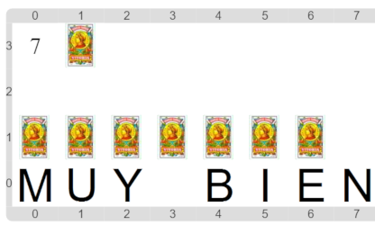

#Actividad 3.1. Todas iguales

En esta actividad tenés que construir un programa que arme un mazo de cartas.
Pero este mazo es muy particular: tiene todas las cartas iguales.
Los datos de entrada son un número y una carta, y el dato de salida tiene que ser una lista
que tenga esa cantidad de cartas, todas iguales a la que viene como dato de entrada.
Como siempre, te mostramos un posible escenario final:

La dificultad está en como _recordar_ los resultados que calculamos hasta ahora en cada paso del recorrido.

> **Las listas también son datos**
>
> Así como podemos ir sumando de a uno a un número cuando cuento, podemos ir agregando elementos de a uno
> a una lista, para construir la lista resultante.
> Y como las listas son datos (con estructura), podemos recordarlas en variables, e ir modificando ese 
> recuerdo, tal cual hacemos con un contador o un acumulador numérico.

[Enunciado en PDF][PDF]

[PDF]: https://raw.githubusercontent.com/gobstones/laprogramacionysudidactica2/master/Proyectos/5.Algoritmos%20sobre%20listas/3.1.Todas%20iguales/assets/resources/description.pdf "Enunciado de 'Todas iguales' en PDF"