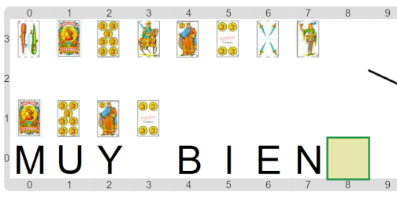

#Actividad 5. Toto, solo los oros

El rey Midas tenía la maldición de convertir a oro todo lo que tocaba.
Por eso, es importante quitar de las cosas que tiene cerca todo lo que no sea de oro.
El propósito en esta actividad es contruir un programa que haga exactamente eso:
informar al final, de las cartas del mazo de entrada, solamente las que sean de oros.

El escenario final te tiene que quedar parecido al siguiente.

Acordate que para procesar una lista podés usar un recorrido sobre sus elementos,
y que podés armar una lista nueva con los resultados del procesamiento 
(_recordando_ lo que ya armaste).
¿Cómo va a ser el procesamiento en esta ocasión? ¿Siempre igual?
¿Cómo elegir cuáles van y cuáles no?

> **Un recorrido con alternativas**
>
> ¿Te acordás de las actividades de _"Dino aprende a no comer chatarra"_ o de _"El rey, el caballo, …"_?
> La estrategia para esta actividad es similar a esas.
