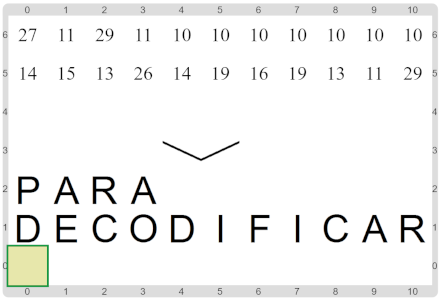

#Actividad 1. En los ojos de la compu

En esta actividad tenés que construir un programa que se encargue de _decodificar_ un mensaje que aparece 
codificado en el escenario. El mensaje tiene la forma de una lista de números, y sabemos que cada número
representa el código de una letra. Tu trabajo es obtener la lista de letras a partir de esos números (o sea
_transformar_ la lista de números en una lista de letras).
Por suerte, la función para decodificar una letra ya viene hecha: `letraDelCódigo_` dado un código, devuelve
la letra correspondiente.

Así se vería un posible escenario final exitoso:

¿Cómo transformar una lista en otra?
¡Ahora es el momento de poner en acción las cosas que aprendimos durante el curso!

> **_"En los ojos de la compu"_**
>
> La actividad la llamamos así porque las computadoras representan las letras a través de números
> (en realidad, representan TODO a través de números… :)). Entonces, si fuésemos como una computadora
> (o sea, si estuviésemos en sus ojos) en lugar de ver las letras, veríamos los números.

&nbsp;

> **¿Cómo se codifican las letrs en las máquinas actuales?**
>
> Los números que usan las computadoras reales no son exactamente los mismos que te mostramos acá;
> y de hecho, no hay una única codificación para las letras y símbolos. Para saber más, podés leer
> sobre el _código ASCII_ (uno de los primeros códigos estandarizados de las computadoras) y también
> sobre UNICODE (una familia de estándares para definir la mayoría de las codificiones que se usan
> actualmente; la ventaja de UNICODE es que sus códigos permiten representar letras en multitud de 
> idiomas diferentes, y no solamente en inglés, como el ASCII).

[Enunciado en PDF][PDF]

[PDF]: 
https://raw.githubusercontent.com/gobstones/laprogramacionysudidactica2/master/Proyectos/6.Representaci%C3%B3n%20de%20la%20informaci%C3%B3n/1.En%20los%20ojos%20de%20la%20compu/assets/resources/description.pdf "Enunciado de 'En los ojos de la compu' en PDF"