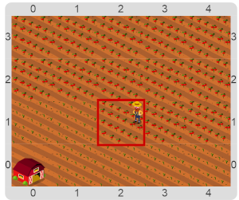
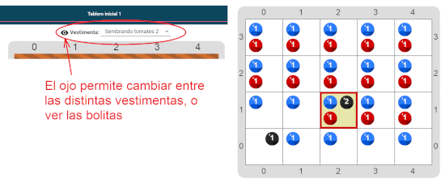

#Proyecto 4.1. Las bambalinas de Gobstones

Ejecutá el programa y observá como el granjero siembra tomates y luego los cosecha.

Luego volvé a ejecutar, pero ahora durante la ejecución desactivá o cambiá la vestimenta con el botón que se muestra en la imagen.

¿En qué se parecen la simulación del granjero, la de repartir caramelos o la de las bolitas? 
Todas tienen la misma estructura lógica, en tanto se trata de distribuir ciertos elementos y 
luego recolectar otros elementos. 
Pero entonces, ¿cómo se representan los elementos dentro de la computadora?
¿Qué diferencia hay entre el granjero, el docente, o el _"cabezal"_ que pone y saca bolitas?

> **Vestimentas**
>
> Las vestimentas son una forma de cambiar la manera de visualizar el efecto de un programa.
> Así, podemos representar cualquier elemento utilizando solamente bolitas.

[Enunciado en PDF][PDF]

[PDF]: https://raw.githubusercontent.com/gobstones/laprogramacionysudidactica2/master/Proyectos/6.Representaci%C3%B3n%20de%20la%20informaci%C3%B3n/4.1.Las%20bambalinas%20d%20Gobstones/assets/resources/description.pdf "Enunciado de 'Las bambalinas de Gobstones' en PDF"
