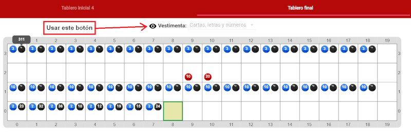

#Actividad 4.2. Las bambalinas de Gobstones (2): Representar el mazo

Esta actividad es idéntica a la actividad "Representar el mazo", salvo que ya se provee la solución a la misma.
El objetivo de la actividad es poder visualizar cómo están codificados algunos de los elementos que hemos venido trabajando,
tales como cartas, números y letras.
Para ello, debe utilizarse el botón de activar y desactivar vestimentas (como se vé en la imagen).

Las bolitas negras representan el código de cada elemento (los '*' representan números grandes -- debe colocarse el mouse sobre ellos para verlos).
¿Podés deducir qué representan las bolitas azules? ¿Y las rojas?

> **Vestimenta mata número**
>
> Ya vimos que desde el punto de vista de las computadoras, todos los elementos son números.
> E hicimos una actividad donde nosotros obteníamos los números de la representación de un mazo.
> Pero ahora podemos ver también que en Gobstones, todo está representado con números (como cantidades
> de bolitas), y son las vestimentas las que nos permiten visualizar los elementos con los que trabajamos.
> 
> ¡Al final, todo lo que vemos en la computadora es una ilusión construída sobre números!

[Enunciado en PDF][PDF]

[PDF]: https://raw.githubusercontent.com/gobstones/laprogramacionysudidactica2/master/Proyectos/6.Representaci%C3%B3n%20de%20la%20informaci%C3%B3n/4.2.Las%20bambalinas%20de%20Gobstones%20-%202da%20parte/assets/resources/description.pdf "Enunciado de 'Las bambalinas de Gobstones (2): Representar el mazo' en PDF"
