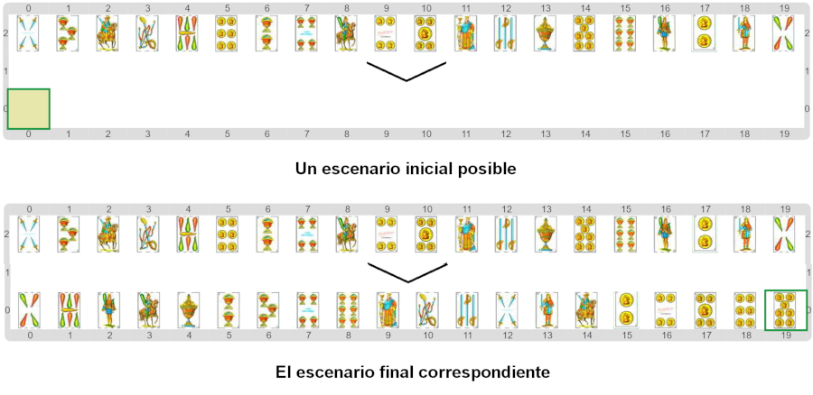

#Actividad 3. Encontrar la carta más chica

En la actividad anterior tenías que ordenar un mazo usando la operación de "la carta más chica de".
En esta actividad el ordenamiento viene hecho, pero vos tenés que hacer esa operación, que falta.
Nuevamente, el escenario debe quedar como en el ejemplo anterior.

Un detalle importante a tener en cuenta es que esta función solo va a trabajar bien si el mazo que
recibe como argumento no está vacío. Esto es así porque si el mazo está vacío, no hay carta más chica…
Este detalle influye también en la forma en que empieza la solución; para guiarte, el inicio del recorrido
ya viene construido.

> **División en subtareas y piezas de software**
>
> La división es subtareas se puede usar de forma muy eficiente para pensar ciertas operaciones 
> (procedimientos o funciones) que luego se pueden reutilizar muchas veces. 
> Los programadores profesionales recurren muchas veces a operaciones que fueron programadas por
> otras personas en forma de piezas de software.
> Los lenguajes profesionales incluyen, entre varias otras cosas, mecanismos para que esta forma
> de reutilizar código sea fácil.

[Enunciado en PDF][PDF]

[PDF]: 
https://raw.githubusercontent.com/gobstones/laprogramacionysudidactica2/master/Proyectos/7.Algoritmos%20m%C3%A1s%20avanzados/3.Encontrar%20la%20carta%20m%C3%A1s%20chica/assets/resources/description.pdf "Enunciado de 'Encontrar la carta más chica' en PDF"
