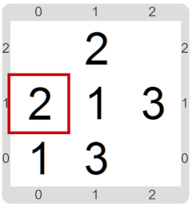

#Actividad 6.2. Sudoku simplificado

Al igual que en el proyecto anterior, tenés que construir un programa que permita jugar a una versión simplificada del Sudoku.
Recordemos que el objetivo del juego es completar la grilla con los números del 1 al 3, sin que se repita ningún número en 
ninguna fila ni ninguna columna. 

La diferencia con el proyecto anterior es que ahora tenés que lograr que si se trata de ingresar un número en una celda que
ya contiene algo, no suceda nada. Nuestra vieja amiga, la alternativa condicional, va a ser útil.

En las siguientes imágenes podés ver cómo se vería el tablero durante el juego, y cómo se vería al terminar, si hiciste 
todo bien.

&nbsp;&nbsp;&nbsp;&nbsp;&nbsp;&nbsp;&nbsp;&nbsp;&nbsp;&nbsp;&nbsp;&nbsp;&nbsp;&nbsp;&nbsp;
&nbsp;&nbsp;&nbsp;&nbsp;&nbsp;&nbsp;&nbsp;&nbsp;&nbsp;&nbsp;&nbsp;&nbsp;&nbsp;&nbsp;&nbsp;

&nbsp;&nbsp;&nbsp;&nbsp;&nbsp;&nbsp;&nbsp;&nbsp;&nbsp;&nbsp;&nbsp;&nbsp;&nbsp;&nbsp;&nbsp;
&nbsp;&nbsp;&nbsp;&nbsp;&nbsp;&nbsp;&nbsp;&nbsp;&nbsp;&nbsp;&nbsp;&nbsp;&nbsp;&nbsp;&nbsp;

> **¡Gracias!**
>
> Esta actividad está inspirada en una idea de Gladys Dapozo, de la Universidad Nacional del NorEste (UNNE).

[Enunciado en PDF][PDF]

[PDF]: https://raw.githubusercontent.com/gobstones/laprogramacionysudidactica2/master/Proyectos/2.Par%C3%A1metros%20y%20Entrada-Salida/6.2.Sudoku%20simplificado/assets/resources/description.pdf "Enunciado de 'Sudoku simplificado' en PDF"
