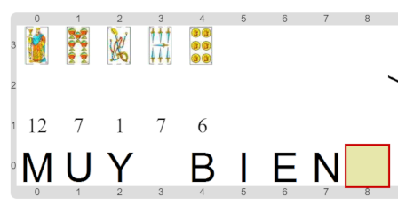

#Actividad 3.2 Los números de las cartas

En esta ocasión el trabajo es obtener una lista de los números de cada una de las cartas del mazo.
O sea, la lista de salida debe tener la misma cantidad de elementos que la lista de entrada, pero 
mientras que la lista de entrada es de cartas (un mazo), la de salida debe serlo de números.
Para eso, la estrategia recomendable es hacer un recorrido sobre la lista de entrada donde el 
procesar elemento es obtener el número de la carta, y agregarlo a la lista de resultados.
Un escenario posible al finalizar es el siguiente:

Básicamente tenés que combinar dos ideas que ya conocés: por un lado la de recorrer una lista (que 
ya viste en varias actividades anteriores), y por el otro, la de generar una lista (como hiciste en
la actividad inmediata anterior).

> **Transformar los elementos de una lista**
>
> En muchos casos los problemas de computación involucran recorrer una serie de datos, y calcular otra
> serie que depende de la primera. Por ejemplo, si tenemos la lista de empleados de una institución, y queremos
> generar las órdenes de pago de sueldos; o una lista de píxeles de una imagen en color, y queremos generar la
> lista de píxeles de la imagen transformada a blanco y negro. ¿Se te ocurre algún otro ejemplo?

[Enunciado en PDF][PDF]

[PDF]: https://raw.githubusercontent.com/gobstones/laprogramacionysudidactica2/master/Proyectos/5.Algoritmos%20sobre%20listas/3.2.Los%20n%C3%BAmeros%20de%20las%20cartas/assets/resources/description.pdf "Enunciado de 'Los números de las cartas' en PDF"