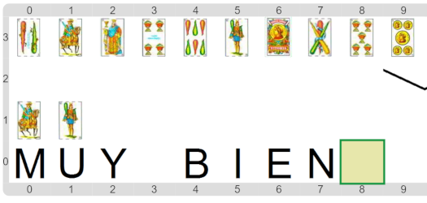

#Actividad 6. La realeza armada

Del reino vecino están envidiosos del rey Midas, y entonces decidieron armar un ejército para invadirlo.
Pero como son un reino particular, solo aceptan en el ejército a los miembros de la realeza.
El propósito en esta actividad es construir un programa que dado un mazo de cartas, informe cuáles son las
cartas que corresponden a ciudadanos de la realeza que poseen armas, para poder integrar el ejército.
El escenario final debería quedarte como el siguiente:

Las figuras (rey, caballo y sota) representan miembros de la realeza, y los palos de Bastos y Espadas representan armas.

> **¡No olvides a las funciones!**
>
> ¿Te acordás cómo usamos funciones en _"Dino aprende a no comer chatarra"_?
> En esta actividad deberías realizar una división en subtareas parecida a esa.
> Y no te olvides de hacer un recorrido para filtrar los elementos de la lista de entrada.

[Enunciado en PDF][PDF]

[PDF]: 
https://raw.githubusercontent.com/gobstones/laprogramacionysudidactica2/master/Proyectos/5.Algoritmos%20sobre%20listas/6.La%20realeza%20armada/assets/resources/description.pdf "Enunciado de 'La realeza armada' en PDF"