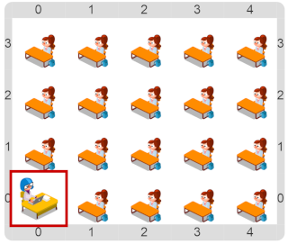

# Proyecto 'Glotón, el robot'

La idea de este proyecto es simplemente ver una simulación usando Gobstones. 
Para eso, tenés que ejecutar el programa que viene construido.
En la simulación se verá a un docente con sus estudiantes que irá visitando a cada uno y dándole un caramelo; luego volverá al escritorio y repetirá la acción de visitarlos pero retirando los papeles de caramelos.

Al finalizar la ejecución reflexionar sobre cómo los problemas del mundo real pueden simularse virtualmente. ¿Cómo creés, en este caso, que se dieron las instrucciones al docente? ¡Mediante un programa!

> **Si no sabés como ejecutar, usá el tutorial**
>
> Si es la primera vez que entrás, el tutorial va a estar activado y se muestra apenas cierres esta descripción. Pero si no está activado y querés verlo, podés activarlo usando el menú de arriba a la izquierda.
>

>
>

[Enunciado en PDF][PDF]

[PDF]: https://raw.githubusercontent.com/Program-AR/proyectos-gobstones-jr/master/Proyectos/Cap.2/201.Glot%C3%B3n,%20el%20robot/assets/resources/description.pdf "Enunciado de 'Glotón, el robot' en PDF"
