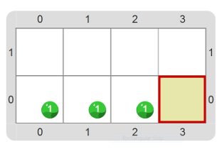

# Proyecto 'La víbora esperando una presa'
Construí un programa para obtener una víbora de bolitas como la siguiente:

Vas a necesitar un comando primitivo diferente de `Poner` y expresiones literales diferentes a los colores. 
¿Cuáles podrían ser? Investigá un poco y probá. ¡Seguro que conseguís que funcione como querés!

[Enunciado en PDF][PDF]

[PDF]: https://raw.githubusercontent.com/Program-AR/proyectos-gobstones-jr/master/Proyectos/Cap.2/204.La%20v%C3%ADbora%20esperando%20una%20presa/assets/resources/description.pdf "Enunciado de 'La víbora esperando una presa' en PDF"
