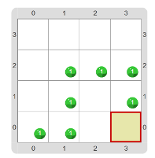

# Proyecto 'La víbora al ataque'

Tenés que hacer algo muy parecido a lo que hiciste en los proyectos anteriores: dibujar una víbora de bolitas. 
Pero esta vez la víbora es más inquieta, y debe ser como la que se muestra en la figura:

> **La clave está en la Rosa de los Vientos**
>
> El comando `Mover` precisa una dirección. En Gobstones, las direcciones son `Norte`, `Este`, `Sur` y `Oeste`. 
> Cuando tengas dudas, chequeá la rosa de los vientos que se encuentra arriba a la derecha. 
> ¡Ah! Un dato interesante: si leés las direcciones desde la N y hacia la izquierda se forma _No sé_.
>

>
>

[Enunciado en PDF][PDF]

[PDF]: https://raw.githubusercontent.com/Program-AR/proyectos-gobstones-jr/master/Proyectos/Cap.2/206.La%20v%C3%ADbora%20al%20ataque/assets/resources/description.pdf "Enunciado de 'La víbora al ataque' en PDF"

