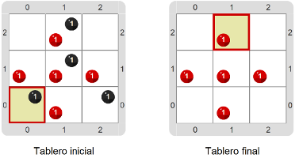
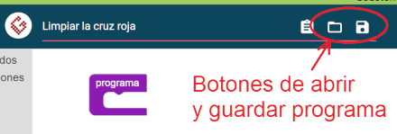

# Proyecto 'La cruz roja'

Un dibujo de la cruz roja hecho con bolitas se manchó con ceniza; el propósito del programa 
que hay que hacer es limpiar la imagen de ceniza, sacando las bolitas negras. 
Construí ese programa. El tablero inicial y el tablero final se dan a continuación.

Fijate que el tablero inicial va a ser siempre el mismo, con lo cual tenés que encontrar qué 
comandos precisás y en qué orden. 
¿Qué pasa si te equivocás en el orden de los comandos? 
Es complicado resolver este problema usando solamente los comandos `Mover` y `Sacar`, ¿no? 

> **El que busca, encuentra**
>
> ¿Habrá más de un programa que funcione para este problema? 
> Para probar, tratá de guardar el programa que hiciste en la computadora y hacer otro distinto. 
> Para guardar el programa, usá el ícono al lado del de seleccionar proyecto. 
> ¡Acordate de ponerle un nombre distinto a cada solución!
> 

> 

[Enunciado en PDF][PDF]

[PDF]: https://raw.githubusercontent.com/Program-AR/proyectos-gobstones-jr/master/Proyectos/Cap.2/208.La%20cruz%20roja/assets/resources/description.pdf "Enunciado de 'La cruz roja' en PDF"

