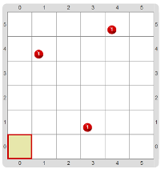
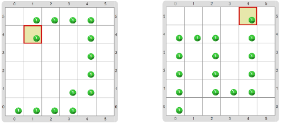

# Proyecto 'La víbora que come manzanas deliciosas'

Como verás, el tablero inicial muestra algunas bolitas rojas (siempre en la misma posición) 
que representan manzanas. El objetivo de la actividad es que dibujes una serie de bolitas verdes, 
que representen a una víbora avanzando hasta cada una de las “manzanas” donde se las “come” 
(o sea, saca la bolita roja). Las manzanas se pueden comer en cualquier orden. 
La víbora no puede pasar por encima de ella misma; es decir, no puede pasar por lugares que ya 
tengan una bolita verde.
El tablero inicial se muestra en la siguiente imagen. 
Tené en cuenta que el cabezal siempre empieza en la esquina suroeste:

Algunos posibles tableros finales se muestran en las imágenes siguientes. 
La variación está en el orden en que se comieron las manzanas. 
Tu programa debería producir un tablero final que coma todas las manzanas, y que podría ser 
uno de los que se muestran u otros diferentes. 
¿Te atrevés a conseguir uno que no sea de los que se muestran?

[Enunciado en PDF][PDF]

[PDF]: https://raw.githubusercontent.com/Program-AR/proyectos-gobstones-jr/master/Proyectos/Cap.2/210.La%20v%C3%ADbora%20que%20come%20manzanas%20deliciosas/assets/resources/description.pdf "Enunciado de 'La víbora que come manzanas deliciosas' en PDF"

