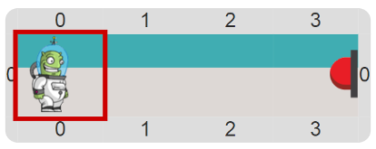

# Proyecto 'El alien toca el botón'

En esta actividad no vamos a trabajar con bolitas… directamente. 
La idea es que en el tablero hay un alien que para poder activar su nave tiene que 
apretar un botón, para lo cual primero tiene que llegar hasta él. 
Entonces, tu trabajo es fácil: escribí un programa que haga que el alien apriete el botón. 
Fijate que no vas a poder usar los comandos primitivos, sino **procedimientos primitivos** que hablan 
del alien y el botón. Investigá un poco el entorno para encontrarlos.

> **El dato**
>
> ¿En qué se diferencian los comandos primitivos y los procedimientos primitivos? 
> Los comandos primitivos, como `Poner`, `Sacar` y `Mover` vienen con Gobstones. 
> En cambio, los **procedimientos primitivos** son _procedimientos_ hechos ad hoc para algunos proyectos, 
> pero no forman parte del lenguaje. De hecho, ¡alguien los programó usando Gobstones!

[Enunciado en PDF][PDF]

[PDF]: https://raw.githubusercontent.com/Program-AR/proyectos-gobstones-jr/master/Proyectos/Cap.3/303.El%20alien%20toca%20el%20bot%C3%B3n/assets/resources/description.pdf "Enunciado de 'El alien toca el botón' en PDF"
