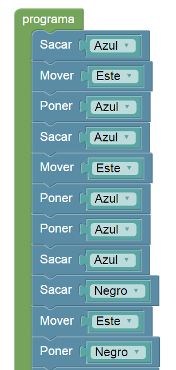

# Proyecto 'Fútbol de robots, sin procedimientos'

En esta actividad solamente tenés que mirar el programa que está realizado, y comprobar 
qué difícil que es entender qué hace el programa cuando no se utilizan procedimientos para 
representar los elementos ni las operaciones del problema. 
¡Es mucho mejor definir procedimientos para representar las ideas!

[Enunciado en PDF][PDF]

[PDF]: https://raw.githubusercontent.com/Program-AR/proyectos-gobstones-jr/master/Proyectos/Cap.3/305.F%C3%BAtbol%20de%20robots,%20sin%20procedimientos/assets/resources/description.pdf "Enunciado de 'Fútbol de robots, sin procedimientos' en PDF"
