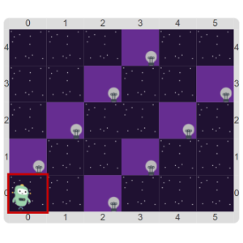

# Proyecto 'Lucho enciende las luces'

El programa a realizar debe instruir a Lucho, nuestro robot de casa, para que encienda todas las luces 
que aparecen en el tablero, que están siempre en el mismo lugar. 
El tablero inicial es:

Lo importante es que pienses de entrada una estrategia de solución, dividiendo en subtareas, y escribas 
procedimientos para expresarlas. 
Para eso, conviene primero nombrar las cosas que vemos: por ejemplo, la diagonal superior de luces, o 
la diagonal inferior. 
Entonces, una buena subtarea sería expresada por un procedimiento llamado `SubirEncendiendoLaDiagonalInferior`.

¿Te atrevés a dar dos programas diferentes, con distintas estrategias de solución para solucionar este problema? 
Fijate que también podés hacer un procedimiento para moverte de una diagonal a la otra… 
Y no te olvides de guardar el programa antes de modificarlo.

> **No existe “la” solución**
>
> Para solucionar un problema dado puede haber más de un programa que sirva. 
> O sea, no existe “la” solución.
> ¡Hay MUCHAS soluciones!

[Enunciado en PDF][PDF]

[PDF]: https://raw.githubusercontent.com/Program-AR/proyectos-gobstones-jr/master/Proyectos/Cap.3/307.Lucho%20enciende%20las%20luces/assets/resources/description.pdf "Enunciado de 'Lucho enciende las luces' en PDF"
