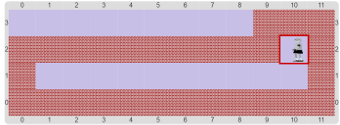

# Proyecto 'El final del pasillo'

Escribí un procedimiento al que tenés que ponerle como nombre 
 
que permita al Beto moverse por un pasillo en forma de L, como el que muestra la figura, hasta llegar 
a la otra punta:

Una vez más, los procedimientos primitivos para representar al Beto ya vienen definidos. 
Tené en cuenta que en esta actividad Beto no puede moverse a donde hay una pared 
(representada por bolitas negras), ya que éstas tienen dispositivos explosivos que se activan por contacto.

Acordate de usar una repetición para las tareas que se repiten mucho.

[Enunciado en PDF][PDF]

[PDF]: https://raw.githubusercontent.com/Program-AR/proyectos-gobstones-jr/master/Proyectos/Cap.3/309.El%20final%20del%20pasillo/assets/resources/description.pdf "Enunciado de 'El final del pasillo' en PDF"
