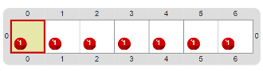

# Proyecto 'Candela, me quemo'

¡Se prende fuego el tablero! 
Valiéndote del procedimiento primitivo 
, 
escribí un procedimiento que apague el incendio del tablero que se ve a continuación:

¿Cuántas veces vas a tener que repetir la acción? 
Fijate que hay siete focos de incendio, pero no hay que moverse tantas veces…

[Enunciado en PDF][PDF]

[PDF]: https://raw.githubusercontent.com/Program-AR/proyectos-gobstones-jr/master/Proyectos/Cap.3/311.Candela,%20me%20quemo/assets/resources/description.pdf "Enunciado de 'Candela, me quemo' en PDF"
