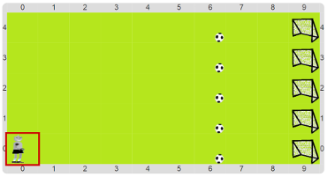

# Proyecto 'El entrenamiento del robot goleador'

En una actividad anterior enseñamos al Beto a patear la pelota. 
Pero como el técnico no entiende que los autómatas siempre hacen las cosas igual, 
insiste en que si Beto va a jugar, tiene que entrenar. 
Y para eso le puso como tarea patear cinco pelotas con una carrera de 6 metros: 
Beto debe patear cada una de las pelotas, pero tomando carrera antes de cada una.

Fijate qué procedimientos están hechos o ya empezados, y completá el código para que el 
programa haga que el entrenador se quede satisfecho al ver cómo Beto hace su tarea. 
El tablero inicial es el siguiente:

Para hacer el programa, acordate que hay que pensar una estrategia de solución y expresarla con procedimientos.
En este caso, los procedimientos que ya fueron comenzados ya tienen la estrategia pensada. 
¡Tenés que descubrir cuál es, para poder completarlos! 
También vas a necesitar los procedimientos primitivos `MoverAlBetoAl`, `MoverLaPelotaAl` y `MoverElPieDelBeto`.

> **Recordatorio**
>
> Recordá que un procedimiento primitivo es uno que viene definido para que no tengas que hacerlo vos ahora, 
> pero que no lo podés ver ni cambiar. ¡Al final del curso vas a poder hacerlos por tu cuenta!

[Enunciado en PDF][PDF]

[PDF]: https://raw.githubusercontent.com/Program-AR/proyectos-gobstones-jr/master/Proyectos/Cap.3/312.El%20entrenamiento%20del%20robot%20goleador/assets/resources/description.pdf "Enunciado de 'El entrenamiento del robot goleador' en PDF"
