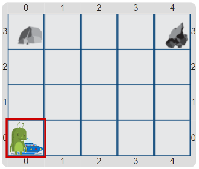

# Proyecto 'El mecánico de naves espaciales'

Utilizando los procedimientos primitivos provistos, escribí un programa que permita que 
el marciano repare su nave y pueda volver a su planeta. 
Para reparar la nave, tiene que conseguir 3 unidades de carbón y 3 unidades de hierro. 
Pero el marciano no puede llevar más de una unidad de mineral por vez. 
Entonces, hay que planificar una estrategia que permita que el marciano haga varios viajes 
para completar su tarea. El tablero inicial muestra al marciano en su nave, y los depósitos de 
carbón y de hierro.

Escribí un procedimiento por cada tarea que haya que hacer y ponele un nombre adecuado. 
Por ejemplo, `IrHastaElCarbón`, `AgarrarUnaPiezaDeCarbón`, `VolverConElCarbón` podrían ser algunos de los 
procedimientos que definas. 
¿Podés organizar bien el programa para que todas las tareas tengan su procedimiento? 
Al leer el programa final, ¿se entiende la estrategia de solución que pensaste?

> **Recordatorio**
>
> Cuando definas los procedimientos para cada una de las tareas, 
> ¡no te olvides de usar repetición para las cosas que se repiten! 
> Además, tené cuidado con las condiciones de borde.

[Enunciado en PDF][PDF]

[PDF]: https://raw.githubusercontent.com/Program-AR/proyectos-gobstones-jr/master/Proyectos/Cap.3/313.El%20mec%C3%A1nico%20de%20naves%20espaciales/assets/resources/description.pdf "Enunciado de 'El mecánico de naves espaciales' en PDF"
