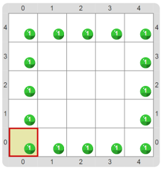

# Proyecto 'Por qué falla'

Mirá el programa de la imagen. Sin ejecutarlo, pensá: ¿Cómo va a comportarse la máquina al intentar realizarlo? Prestá atención a los tipos de datos de los argumentos que se utilizan en el programa.

Para terminar corregí todos los errores para que el programa haga lo que se espera. ¿Cómo sabés qué es lo que se espera que el programa haga? ¿Cuántos errores hay? Esto es lo que deberías obtener al final.

[Enunciado en PDF][PDF]

[PDF]: https://raw.githubusercontent.com/Program-AR/proyectos-gobstones-jr/master/Proyectos/Cap.4/401.Por%20qu%C3%A9%20falla/assets/resources/description.pdf "Enunciado de 'Por qué falla' en PDF"
