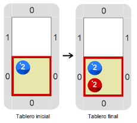
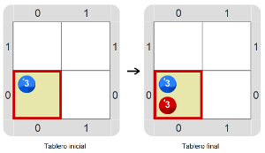
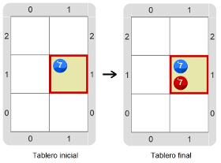

# Proyecto 'El cabezal juega a ser mimo'

En esta actividad tenés que construir un programa que ponga bolitas rojas. El tema es que la cantidad de bolitas rojas que hay que colocar no la conocés de antemano: el programa tiene que poner bolitas rojas para imitar la cantidad de bolitas azules. 
A su vez, el programa tiene que funcionar en varios tableros diferentes. Te mostramos algunos tableros iniciales y sus correspondientes tableros finales.
 

&nbsp;&nbsp;&nbsp;&nbsp;&nbsp;&nbsp;&nbsp;&nbsp;&nbsp;&nbsp;&nbsp;&nbsp;&nbsp;&nbsp;&nbsp;&nbsp;&nbsp;&nbsp;&nbsp;&nbsp;

&nbsp;&nbsp;&nbsp;&nbsp;&nbsp;&nbsp;&nbsp;&nbsp;&nbsp;&nbsp;&nbsp;&nbsp;&nbsp;&nbsp;&nbsp;&nbsp;&nbsp;&nbsp;&nbsp;&nbsp;

Recordá que el mismo programa tiene que servir para transformar cualquiera de los tableros iniciales en el tablero final correspondiente. Probalo cuantas veces necesites. Recomendación: explorá el entorno para ver si hay alguna herramienta nueva que te permita lograrlo.

> **Ampliando**
>
> Los mimos son actores que utilizan la mímica como único medio teatral (no hablan), y cuando realizan actuaciones en la calle se especializan en imitar a otras personas.

[Enunciado en PDF][PDF]

[PDF]: https://raw.githubusercontent.com/Program-AR/proyectos-gobstones-jr/master/Proyectos/Cap.4/402.El%20cabezal%20juega%20a%20ser%20mimo/assets/resources/description.pdf "Enunciado de 'El cabezal juega a ser mimo' en PDF"
