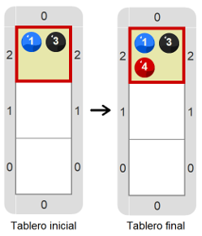
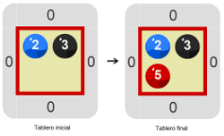
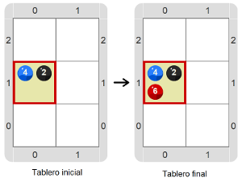

# Proyecto 'El mimo que suma'

Nuevamente hay que hacer que el cabezal juegue a ser un mimo, pero en lugar de imitar solamente las bolitas azules, ahora hay que imitar _al mismo tiempo_ las bolitas azules y las negras. El desafío es que en tu programa uses una única repetición. Explorá el entorno para encontrar la manera en la que el número de bolitas azules y el número de bolitas negras se puedan usar juntos en la repetición. Te mostramos algunos tableros iniciales y finales:
 

&nbsp;&nbsp;&nbsp;&nbsp;&nbsp;&nbsp;&nbsp;&nbsp;&nbsp;&nbsp;&nbsp;&nbsp;&nbsp;&nbsp;&nbsp;&nbsp;&nbsp;&nbsp;&nbsp;&nbsp;

&nbsp;&nbsp;&nbsp;&nbsp;&nbsp;&nbsp;&nbsp;&nbsp;&nbsp;&nbsp;&nbsp;&nbsp;&nbsp;&nbsp;&nbsp;&nbsp;&nbsp;&nbsp;&nbsp;&nbsp;

Recordá que el mismo programa tiene que servir para transformar cualquiera de los tableros iniciales en el tablero final correspondiente. Probalo cuantas veces necesites. Recomendación: explorá el entorno para ver si hay alguna herramienta nueva que te permita lograrlo.

> **Ampliando**
>
> Los mimos son actores que utilizan la mímica como único medio teatral (no hablan), y cuando realizan actuaciones en la calle se especializan en imitar a otras personas.

[Enunciado en PDF][PDF]

[PDF]: https://raw.githubusercontent.com/Program-AR/proyectos-gobstones-jr/master/Proyectos/Cap.4/403.El%20mimo%20que%20suma/assets/resources/description.pdf "Enunciado de 'El mimo que suma' en PDF"
