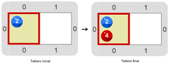
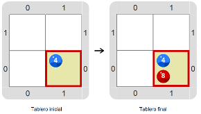
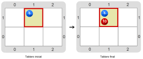

# Proyecto 'Super mimo multiplica'

Esta vez el mimo tiene que imitar nuevamente a las bolitas azules pero ahora tiene que poner el doble de bolitas rojas que de azules. El desafío, nuevamente, es hacerlo con una única repetición y esta vez además, la solución debe tener un solo comando `Poner` y usar una sola vez la expresión `nroBolitas`. Mirá algunas de las combinaciones de tablero inicial y final.
 

&nbsp;&nbsp;&nbsp;&nbsp;&nbsp;&nbsp;&nbsp;&nbsp;&nbsp;&nbsp;&nbsp;&nbsp;&nbsp;&nbsp;&nbsp;&nbsp;&nbsp;&nbsp;&nbsp;&nbsp;

&nbsp;&nbsp;&nbsp;&nbsp;&nbsp;&nbsp;&nbsp;&nbsp;&nbsp;&nbsp;&nbsp;&nbsp;&nbsp;&nbsp;&nbsp;&nbsp;&nbsp;&nbsp;&nbsp;&nbsp;

**Pista:** sale parecido al de _“El mimo que suma”_...

Recordá que el mismo programa tiene que servir para transformar cualquiera de los tableros iniciales en el tablero final correspondiente. Probalo cuantas veces necesites. Recomendación: explorá el entorno para ver si hay alguna herramienta nueva que te permita lograrlo.

> **Ampliando**
>
> Los mimos son actores que utilizan la mímica como único medio teatral (no hablan), y cuando realizan actuaciones en la calle se especializan en imitar a otras personas.

[Enunciado en PDF][PDF]

[PDF]: https://raw.githubusercontent.com/Program-AR/proyectos-gobstones-jr/master/Proyectos/Cap.4/404.Super%20mimo%20multiplica/assets/resources/description.pdf "Enunciado de 'Super mimo multiplica' en PDF"
