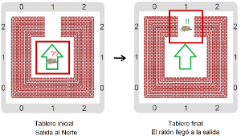
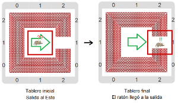
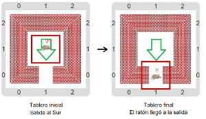
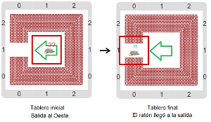

# Proyecto 'Escapar de la jaula'

Un ratón está atrapado en una jaula y necesita ayuda para encontrar la salida. Tenés que construir un procedimiento `AyudarAlRatonASalir` que ayude al ratón a lograrlo. Hay un procedimiento primitivo para mover al ratón, pero la dirección que tenés que darle como argumento depende de cada jaula: fijate que en el piso están marcadas flechas que le indican al ratón la dirección que debe tomar. Vas a tener que explorar el entorno para descubrir alguna forma de usar en el programa la dirección a la que apunta la flecha. Cuando la encuentres, probá usar eso como argumento del procedimiento que mueve al ratón. Te mostramos algunos tableros iniciales, y sus correspondientes tableros finales.
 

&nbsp;&nbsp;&nbsp;&nbsp;&nbsp;&nbsp;&nbsp;&nbsp;&nbsp;&nbsp;&nbsp;&nbsp;&nbsp;&nbsp;&nbsp;&nbsp;&nbsp;&nbsp;&nbsp;&nbsp;

&nbsp;&nbsp;&nbsp;&nbsp;&nbsp;&nbsp;&nbsp;&nbsp;&nbsp;&nbsp;&nbsp;&nbsp;&nbsp;&nbsp;&nbsp;&nbsp;&nbsp;&nbsp;&nbsp;&nbsp;

[Enunciado en PDF][PDF]

[PDF]: https://raw.githubusercontent.com/Program-AR/proyectos-gobstones-jr/master/Proyectos/Cap.4/405.Escapar%20de%20la%20jaula/assets/resources/description.pdf "Enunciado de 'Escapar de la jaula' en PDF"
