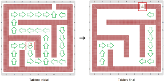
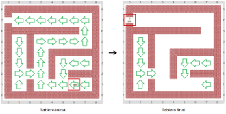
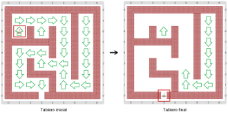
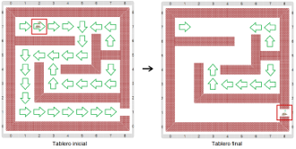

# Proyecto 'Laberinto'

¿Te acordás del ratón que escapó de la jaula? Resulta que a la salida lo estaban esperando para ponerlo en un laberinto y ver si podía escaparse de él. Por suerte, en el laberinto también hay flechas que marcan el camino y sabe que tiene que dar 20 pasos para salir. Construí y probá el procedimiento `SalirDelLaberinto` que le indique al ratón lo que debe hacer para salir. Te mostramos algunos laberintos, y cómo tiene que quedar al terminar:
           

&nbsp;&nbsp;&nbsp;&nbsp;&nbsp;&nbsp;&nbsp;&nbsp;&nbsp;&nbsp;&nbsp;&nbsp;&nbsp;&nbsp;&nbsp;&nbsp;&nbsp;&nbsp;&nbsp;&nbsp;

&nbsp;&nbsp;&nbsp;&nbsp;&nbsp;&nbsp;&nbsp;&nbsp;&nbsp;&nbsp;&nbsp;&nbsp;&nbsp;&nbsp;&nbsp;&nbsp;&nbsp;&nbsp;&nbsp;&nbsp;

           
La idea es fácil: en cada paso hay que ver para dónde apunta la flecha, y sacarla antes de moverse. Revisá los procedimientos y funciones primitivos para ver cómo hacer. ¡Todos las herramientas son conocidas, pero hay que usarlas juntas!

> **Consejo**
>
> Podés definir un procedimiento `AvanzarUnPasoSiguiendoLaFlecha` para hacer uno de los movimientos. Para hacerlo podés mirar cómo hiciste en _“Escapar de la jaula”_, porque la idea es parecida...

[Enunciado en PDF][PDF]

[PDF]: https://raw.githubusercontent.com/Program-AR/proyectos-gobstones-jr/master/Proyectos/Cap.4/407.Laberinto/assets/resources/description.pdf "Enunciado de 'Laberinto' en PDF"
