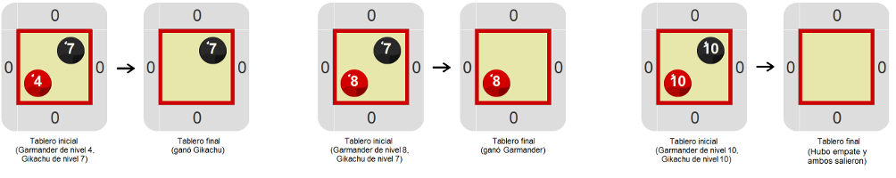

# Proyecto 'Que gane el mejor'

Los Gobstomon son pequeñas criaturas mágicas que habitan en la naturaleza, y que son adoptadas como mascotas por algunas personas, que las entrenan para realizar combates Gobstomon. Hay cuatro clases de Gobstomon: los Gikachu, representados en Gobstones con bolitas negras, los Garmander, representados con bolitas rojas, los Golbasaur representados con bolitas verdes y los Gobartle representados con bolitas azules. Cada Gobstomon tiene un nivel, representado por la cantidad de bolitas del color correspondiente. Entonces, un Gikachu de nivel 17, por ejemplo, será representado por 17 bolitas negras, y un Garmander de nivel 8 será representado por 8 bolitas rojas.  Por ejemplo, en las imágenes de más abajo se pueden ver un Garmander de nivel 4 y un Gikachu de nivel 7 en el primer tablero, un Garmander de nivel 8 y un Gikachu de nivel 7 en el segundo tablero, y un Garmander y un Gikachu de nivel 10 en el tercer tablero. Cuando dos entrenadores envían a sus Gobstomon a una celda del tablero, se produce un combate. Las reglas del combate son simples: el Gobstomon con más nivel gana; el otro se retira del tablero y vuelve con su entrenador; si los dos tienen el mismo nivel, ambos deben ser retirados.

Mirá las partes que ya vienen hechas, incluído el procedimiento primitivo `SacarTodas(...)`. El propósito del programa que tenés que hacer simular el resultado de distintos combates Gobstomon entre un Gikachu y un Garmander. Para eso tenés que construir un procedimiento `PelearGikachuVSGarmander`. En cada tablero inicial habrá exactamente un Gikachu y un Garmander, aunque no sabemos de qué nivel. El programa debe primero verificar si hay empate y sacarlos a ambos, y si no hay empate, entonces quitar del tablero al Gobstomon de menor nivel. Te mostramos algunos tableros iniciales y sus correspondientes tableros finales.

Parece que vas a precisar algunas alternativas condicionales… Para saber el nivel de un Gobstomon podés usar la expresión primitiva `nroBolitas`. ¿Pero cómo podés hacer para hacer la condición que diga si los dos niveles _son iguales_? ¿Y para saber cuál de los dos niveles _es mayor_? Buscá en el entorno de Gobstones. 

[Enunciado en PDF][PDF]

[PDF]: https://raw.githubusercontent.com/Program-AR/proyectos-gobstones-jr/master/Proyectos/Cap.4/410.Que%20gane%20el%20mejor/assets/resources/description.pdf "Enunciado de 'Que gane el mejor' en PDF"

