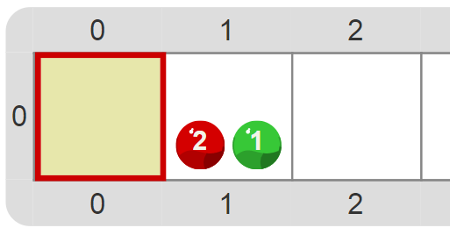

# Proyecto 'Y también…'

En este proyecto también se representan flores, pero con una diferencia interesante respecto del anterior: en lugar de representarse con dos bolitas rojas, en éste las flores se representan con dos rojas y una verde. Tu trabajo es completar las definiciones de `PlantarFlor` y `hayFlor` para tener en cuenta la nueva representación. La condición que tenés que definir para saber si hay una flor está compuesta por dos partes: preguntar si hay bolitas rojas _y también_ preguntar si hay una bolita verde. Como siempre, la caja de herramientas puede tener alguna nueva herramienta que te ayude con este problema. 

           
[Enunciado en PDF][PDF]

[PDF]: https://raw.githubusercontent.com/Program-AR/proyectos-gobstones-jr/master/Proyectos/Cap.4/413.Y%20tambi%C3%A9n%E2%80%A6/assets/resources/description.pdf "Enunciado de 'Y también…' en PDF"
