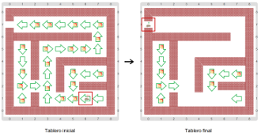
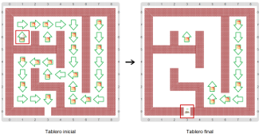

# Proyecto 'Laberinto con queso'

Una vez más el ratón está en el laberinto, a 20 pasos de distancia de la salida. Pero esta vez hay una diferencia: en algunos lugares del laberinto hay pedacitos de queso desperdigados. Completá el programa para que el ratón pueda salir del laberinto, como antes, pero comiéndose todo el queso que encuentra por el camino; los quesos que no están en el camino no los va a comer. Como otras veces, te mostramos algunos tableros iniciales y sus correspondientes tableros finales:
          

&nbsp;&nbsp;&nbsp;&nbsp;&nbsp;&nbsp;&nbsp;&nbsp;&nbsp;&nbsp;&nbsp;&nbsp;&nbsp;&nbsp;&nbsp;&nbsp;&nbsp;&nbsp;&nbsp;&nbsp;

&nbsp;&nbsp;&nbsp;&nbsp;&nbsp;&nbsp;&nbsp;&nbsp;&nbsp;&nbsp;&nbsp;&nbsp;&nbsp;&nbsp;&nbsp;&nbsp;&nbsp;&nbsp;&nbsp;&nbsp;

          
Fijate que no tenés que hacer todo el programa. Hay bastantes partes que ya están hechas. Vos tenés que hacer las funciones y completar dos procedimientos. Para hacer las funciones recordá cómo se representan los diferentes elementos:
* las flechas se representan con bolitas rojas: 1 roja representa la flecha apuntando al Norte, 2 rojas al Este, 3 rojas al Sur y 4 rojas al Oeste.
* los quesos se representan con 1 bolita verde ¡y la salida con 2 ó 3 verdes! Que el ratón no se confunda y piense que hay un queso en la salida…
Vas a tener que repasar cómo usar el operador de igualdad.

Un detalle interesante para mirar es cómo está hecho el procedimiento para avanzar un paso según la flecha: usa alternativas, pero lo hace de forma que cada pregunta solo se hace si las anteriores respondieron que no, y por eso cada nueva alternativa aparece en la rama-del-si-no de la anterior. Esto es una forma de elegir entre múltiples alternativas para asegurar que se mueva una sola vez por cada llamado al procedimiento.
           
[Enunciado en PDF][PDF]

[PDF]: https://raw.githubusercontent.com/Program-AR/proyectos-gobstones-jr/master/Proyectos/Cap.4/414.Laberinto%20con%20queso/assets/resources/description.pdf "Enunciado de 'Laberinto con queso' en PDF"
