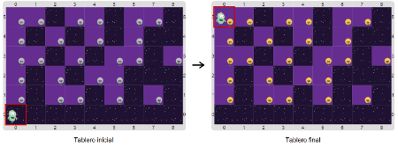
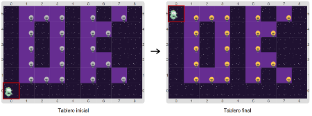

# Proyecto 'Lucho recargado'

El robot Lucho otra vez tiene que prender las luces, y por supuesto, vos tenés que completar el programa para que lo haga. Hay 6 filas de luces, y cada fila tiene 9 lugares, y no hay luces en todas las celdas, así que Lucho tiene que ir con cuidado, preguntando si hay o no una luz antes de prenderla. Completá el programa para ayudar a Lucho con su tarea. Como siempre, te mostramos algunos tableros iniciales y sus correspondientes tableros finales:

&nbsp;&nbsp;&nbsp;&nbsp;&nbsp;&nbsp;&nbsp;&nbsp;&nbsp;&nbsp;&nbsp;&nbsp;&nbsp;&nbsp;&nbsp;&nbsp;&nbsp;

Vas a necesitar saber cómo es la representación de los elementos y las particularidades de las operaciones:
* una luz apagada se representa con 1 bolita azul,
* una luz prendida se representa con 2 bolitas azules,
* para saber si hay luz, hay que ver si hay una luz prendida _o bien_ una luz apagada,
* el robot se representa con una bolita negra y el cabezal debe estar siempre sobre él,
* para moverse una fila al Norte, Lucho debe estar en el borde Oeste.

Cuando construyas los procedimientos para expresar la estrategia, no te olvides de tener en cuenta las condiciones de borde en las repeticiones, y de encender una luz solamente cuando corresponde. Si te sentís confundido por la cantidad de procedimientos y funciones, ordenalos en tres grupos: los que representan elementos, los que representan operaciones y los que expresan la estrategia de solución.
           
[Enunciado en PDF][PDF]

[PDF]: https://raw.githubusercontent.com/Program-AR/proyectos-gobstones-jr/master/Proyectos/Cap.4/415.Lucho%20recargado/assets/resources/description.pdf "Enunciado de 'Lucho recargado' en PDF"
