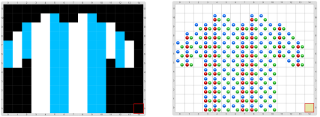

# Proyecto 'Pintando la camiseta de colores'

En este proyecto vas a encontrar ya empezado un programa que dibuja una camiseta con dos colores. Pero hay un problema: los procedimientos `PintarConColorPrincipal` y `PintarConColorSecundario` no están hechos. Tu trabajo, entonces, es implementar esos dos procedimientos para efectivamente representar la imagen de una camiseta de fútbol. Un detalle importante es que estos procedimientos deben poner entre 0 y 4 bolitas de los colores Rojo, Verde o Azul; si ponés otras cosas, la vestimenta no va a servir…
Experimentá con diferentes combinaciones de bolitas rojas, azules y verdes, siempre no más de 4 de cada una, para obtener diferentes camisetas. Te mostramos cómo quedaría una posible combinación de colores con y sin vestimenta:
           

> **Recordatorio**
>
>No te olvides de usar las herramientas que aprendiste para no tener que repetir más veces de las necesarias el comando Poner.

.

> **El dato**
>
>La codificación de colores usando Rojo, Verde y Azul se conoce como codificación RGB (por los nombres de los colores en inglés, Red, Green, Blue). Usualmente, esa codificación usa 3 números entre 0 y 255: 256 posibilidades, representables con 8 bits por color, 24 bits en total. Acá, en cambio, utilizamos números entre 0 y 4, obteniendo en total 5 posibilidades por color.

          
[Enunciado en PDF][PDF]

[PDF]: https://raw.githubusercontent.com/Program-AR/proyectos-gobstones-jr/master/Proyectos/Cap.5/501.Pintando%20la%20camiseta%20de%20colores/assets/resources/description.pdf "Enunciado de 'Pintando la camiseta de colores' en PDF"
