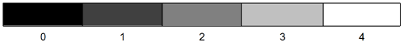
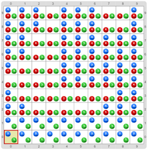
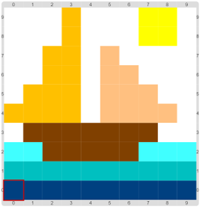
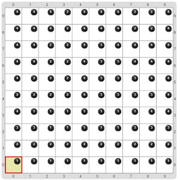
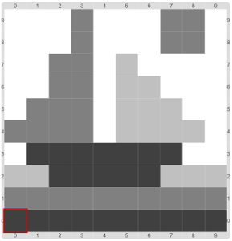

# Proyecto 'Dibujando en escalas de grises'

En el tablero inicial hay una imagen en colores, hecha con la codificación RGB del ejercicio anterior: entre 0 y 4 bolitas rojas, verdes y azules en cada celda. Tenés que completar el programa para que la imagen se transforme en una hecha solamente en escala de grises. Para representar grises vamos a usar también entre 0 y 4 bolitas, pero de color negro; el tono de gris está dado por la cantidad de bolitas negras, como te muestra la imagen, donde también podés ver un tablero inicial, y su correspondiente tablero final. Fijate que falta algo en la función `promedioDeColoresRGB`, que devuelve el promedio de bolitas rojas, azules y verdes, y también en los procedimientos `ConvertirAPíxelMonocromático` y `CodificarTonoDeGris`, que reemplaza las bolitas de los colores rojo, verde y azul de una celda (que representa a un píxel) por la cantidad adecuada de bolitas negras.  

                 

&nbsp;&nbsp;&nbsp;&nbsp;&nbsp;

&nbsp;&nbsp;&nbsp;&nbsp;&nbsp;&nbsp;&nbsp;&nbsp;&nbsp;&nbsp;&nbsp;&nbsp;&nbsp;&nbsp;&nbsp;&nbsp;&nbsp;&nbsp;&nbsp;&nbsp;&nbsp;
&nbsp;&nbsp;&nbsp;&nbsp;&nbsp;&nbsp;&nbsp;&nbsp;&nbsp;&nbsp;&nbsp;&nbsp;&nbsp;&nbsp;&nbsp;&nbsp;&nbsp;&nbsp;&nbsp;&nbsp;&nbsp;

&nbsp;&nbsp;&nbsp;&nbsp;&nbsp;

>  **Vocabulario**
>
> El término monocromático significa “de un solo color” y hace referencia a que se utiliza solamente el color Negro, en diferentes intensidades, por ejemplo, para representar una imagen en escala de grises.

           
[Enunciado en PDF][PDF]

[PDF]: https://raw.githubusercontent.com/Program-AR/proyectos-gobstones-jr/master/Proyectos/Cap.5/502.Dibujando%20en%20escalas%20de%20grises/assets/resources/description.pdf "Enunciado de 'Dibujando en escalas de grises' en PDF"
