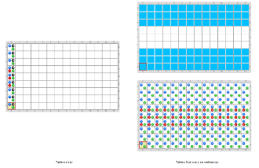

# Proyecto 'Compresión de imágenes'

Mirá alguno de los tableros iniciales. Los tableros son dibujos de diferentes banderas, pero con la información codificada de una forma que ocupa menos espacio que en el formato RGB; decimos que la imagen está codificada en forma **comprimida**. Tu trabajo es completar el programa para que cambie la codificación a la forma RGB que vimos en las actividades anteriores; decimos que la imagen se **descomprime**, porque deja de estar comprimida y podemos ver su contenido original, que sí tiene sentido para nosotros. Para eso tenés que completar los procedimientos y funciones ya comenzados; a casi todos les falta algo.

La codificación comprimida solamente tiene bolitas en la primera celda de cada fila. En cada celda se indica un color RGB con bolitas rojas, verdes y azules, y una longitud en bolitas negras, que es en cuántas celdas de esa fila se repite el color indicado.

Te mostramos un posible tablero inicial y su correspondiente tablero final, con y sin vestimenta.

          
[Enunciado en PDF][PDF]

[PDF]: https://raw.githubusercontent.com/Program-AR/proyectos-gobstones-jr/master/Proyectos/Cap.5/503.Compresi%C3%B3n%20de%20im%C3%A1genes/assets/resources/description.pdf "Enunciado de 'Compresión de imágenes' en PDF"
