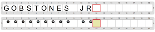

# Proyecto 'Representando caracteres'

Construí un programa que escriba tu nombre. Para representar las 27 letras del alfabeto castellano y el espacio, vamos a utilizar bolitas negras, según la siguiente codificación:

 * Espacio → 0 bolitas negras
 * A → 1 bolita negra
 * B → 2 bolitas negra
 * C → 3 bolitas negras
 * …
 * X → 25 bolitas negras
 * Y → 26 bolitas negras
 * Z → 27 bolitas negras
 
Tenés que construir un procedimiento por cada carácter, que ponga la cantidad de bolitas correspondiente al mismo en la celda actual. Te mostramos cómo quedaría un posible tablero final, con y sin vestimenta.

          

> **¿Sabías que...?**
>
> En las computadoras se utiliza un código llamado ASCII? (Se pronuncia “aski”.) En ese código, la letra A se representa con el número 65 y el espacio con el número 32. Esto es así porque hay otra serie de caracteres representados, además de las letras. 
> Los archivos que no contienen datos adicionales, sino solamente la secuencia de caracteres codificados, se conocen como **archivos de texto plano**. 

[Enunciado en PDF][PDF]

[PDF]: https://raw.githubusercontent.com/Program-AR/proyectos-gobstones-jr/master/Proyectos/Cap.5/504.Representando%20caracteres/assets/resources/description.pdf "Enunciado de 'Representando caracteres' en PDF"
