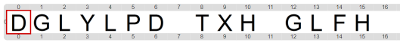

# Proyecto 'Mensajes secretos'

El emperador de Roma alrededor del año 50 a.C., Julio César, enviaba mensajes secretos a sus generales en cartas. Para evitar que sus enemigos descubrieran sus secretos si capturaban a uno de sus mensajeros, ideó un mecanismo para ocultar el significado del texto. Para ello, él y sus generales se ponían de acuerdo en un número, al que llamaremos el _número del César_, y luego escribían cada carácter del texto sumándole ese número al código del mismo. Por ejemplo, si el número del César fuese el 3, la ‘A’ se escribiría como ‘D’: 1 bolita negra que representa la ‘A’ más las 3 bolitas del número del César son 4 bolitas negras, es decir una ‘D’. Y la ‘B’ como ‘E’: 2 bolitas de la ‘B’ más las 3 indicadas por el número del César son 5 bolitas. Entonces podemos cifrar palabras enteras:

| Texto original    | ABCDEFGHIJKLMNÑOPQRSTUVWXYZ     | HOLA     | SECRETO     | 
|:-----------------:|:-------------------------------:|:--------:|:-----------:|
| **Texto cifrado** | **DEFGHIJKLMNÑOPQRSTUVWXYZABC** | **KRÑD** | **VHFUHWR** |

Te mostramos un posible mensaje cifrado:

Elegí junto con un compañero un número del César (y modificá la función `númeroDelCésar` para que use ese número), y construí dos procedimientos:

1. `CifrarTexto`, que cifra un texto de a lo sumo 20 caracteres usando el cifrado de César con el número elegido.
2. `DescifrarTexto`, que decscifra un texto de a lo sumo 20 caracteres usando el mecanismo inverso al cifrado de César. Fijate que tenés que usar el mismo número del César que cuando cifraste el mensaje.

Para construir estos procedimientos te puede resultar útil hacer procedimientos para cifrar y descifrar un carácter, y luego usar una repetición; también vas a precisar los procedimientos de representar caracteres que hiciste en la actividad _“Representando caracteres”_, y que te damos ya hechos para que te concentres en el cifrado y descifrado.

Al cifrar un carácter, si el resultado supera el 27 tenés que _ajustar el exceso_, sacando 27 bolitas, para volver al principio del alfabeto y utilizar los primeros caracteres. Por ejemplo, si el número del Cesár elegido es 3, para cifrar la ‘Z’ que se representa con 27 bolitas  deberíamos sumarle 3 bolitas más, dando 30; pero como el resultado supera el número total de letras, hacemos el ajuste del exceso sacando 27 bolitas, por lo que quedan solo 3. Así obtenemos que la ‘Z’ cifrada resulta en una ‘C’.

Al descifrar vas a tener que hacer al revés: si la cantidad de bolitas es menor o igual que el número del César, tenés que _ajustar las faltantes_, agregando 27 bolitas _antes_ de sacar, para obtener los códigos del final del alfabeto: en el ejemplo descifrar una A generaría una X. 

Te damos hechos los procedimientos `AjustarExceso` y `AjustarFaltantes` para llevar a cabo las dos tareas mencionadas.

Después que hagas el programa, elegí un mensaje, cifralo, y anotáselo a un compañero para que lo descifre. Y que él haga lo mismo. También podés no decirle con qué número del César cifraste el mensaje, y que él tenga que descubrirlo, probando varios números. 

[Enunciado en PDF][PDF]

[PDF]: https://raw.githubusercontent.com/Program-AR/proyectos-gobstones-jr/master/Proyectos/Cap.5/591.Mensajes%20secretos/assets/resources/description.pdf "Enunciado de 'Mensajes secretos' en PDF"
