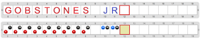

# Proyecto 'Texto en colores'

Tenés que construir un programa que, otra vez, escriba tu nombre y apellido. Pero esta vez el nombre tiene que estar en color rojo, y el apellido tiene que estar en azul. Para eso, precisás extender la representación de la actividad _“Representando caracteres”_, para que ahora codifique también el color, lo cual podés hacer agregando un color representado con la codificación RGB de 125 colores en cada letra. 

> **Ampliando**
>
> A cada una de las características extra de un carácter se la llama **atributo**. Además del atributo del color de la letra, en los editores se puede modificar el color del fondo, si la letra está en negrita, en itálica o subrayada, la fuente del tipo de letras, y muchos otros atributos. Y no solamente los caracteres tienen atributos: también los párrafos, el texto entero y otros elementos. Cada una de estas cosas se codifica de manera diferente en cada editor de textos.

[Enunciado en PDF][PDF]

[PDF]: https://raw.githubusercontent.com/Program-AR/proyectos-gobstones-jr/master/Proyectos/Cap.5/592.Texto%20en%20colores/assets/resources/description.pdf "Enunciado de 'Texto en colores' en PDF"
