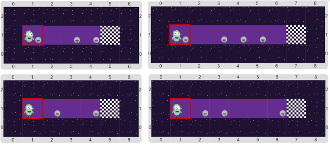

# Proyecto 'Super Lucho 2'

Y ahí va Lucho de nuevo a prender todas las luces. Igual que en _“Super Lucho 1”_, no sabemos cuánto mide la fila, pero ahora hay posiciones que no tienen luz. Algunos de los tableros iniciales son:

Parece que vas a tener que combinar la herramienta que encontraste para _“Super Lucho 1”_ con la alternativa condicional del capítulo 3… ¡No te olvides de dividir en subtareas!

> **Un consejo**
>
>Cuando tengas que combinar varias herramientas de programación, siempre acordate que lo mejor es dividir primero en subtareas, y que cada procedimiento que representa a una subtarea utilice solamente **_una_** de las herramientas.

[Enunciado en PDF][PDF]

[PDF]: https://raw.githubusercontent.com/Program-AR/proyectos-gobstones-jr/master/Proyectos/Cap.7/706.Super%20Lucho%202/assets/resources/description.pdf "Enunciado de 'Super Lucho 2' en PDF"

