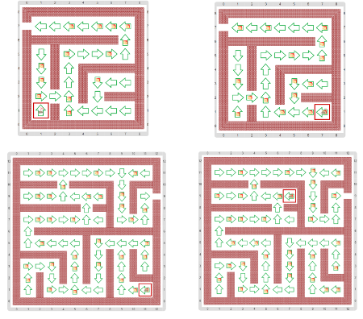

# Proyecto 'Laberinto con queso, recargado'

Otra vez más el ratón está en el laberinto, como en la actividad _“Laberinto con queso”_, y hay queso tirado en el piso en distintos lugares; y como antes, las flechas indican para dónde ir para llegar a la salida. La diferencia con las veces anteriores es que ahora no se sabe a qué distancia está la salida. 
Completá el programa de la actividad para que el ratón pueda salir de cualquier laberinto que cumpla estas condiciones. Te mostramos algunos tableros iniciales:

           
[Enunciado en PDF][PDF]

[PDF]: https://raw.githubusercontent.com/Program-AR/proyectos-gobstones-jr/master/Proyectos/Cap.7/707.Laberinto%20con%20queso,%20recargado/assets/resources/description.pdf "Enunciado de 'Laberinto con queso, recargado' en PDF"
