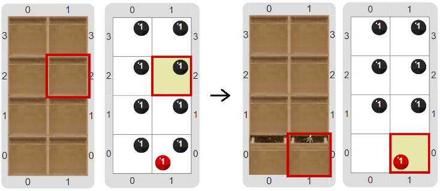

# Proyecto '¿Dónde puse las llaves?'

¿Alguna vez te pasó de ver a alguien buscando las llaves, porque no sabe dónde las dejó? En ocasiones en un programa también hay que buscar algo, como por ejemplo, una celda especial. En esta actividad vamos a hacer un programa para buscar: tenés que completar el programa para que la máquina encuentre las llaves. Cada celda del tablero representa un cajón en un armario, y sabemos que las llaves están en alguno de los cajones, pero la máquina no sabe en cuál. La forma de resolverlo es realizar un **recorrido de búsqueda**, que es un recorrido que en lugar de recorrer todas celdas hasta el final, frena cuando encuentra lo que está buscando. La idea es que la máquina recorra las celdas empezando por la esquina suroeste, y avanzando hacia el Este primero y después hacia el Norte. Te mostramos un tablero inicial posible, y su correspondiente tablero final; fijate que al principio todos los cajones están cerrados, pero al final no lo tuvo que abrir todos. Y tené en cuenta que puede ser que el cabezal no empiece en la esquina sureste...

Para poder construir los procedimientos y funciones necesarios, tenés que saber cómo es la representación de los elementos: un cajón cerrado se representa con una bolita negra en la celda; las llaves se representan con una bolita roja; y un cajón abierto se representa con una celda sin la bolita negra.

¿Qué va a pasar con tu programa si las llaves no están en ningún cajón?

> **Recordatorio**
>
> Un **recorrido** tiene varias subtareas: una para preparar el recorrido, una para procesar cada elemento, una para pasar al siguiente elemento y una pregunta sobre si quedan elementos para procesar. En un **recorrido de búsqueda**, no hace falta procesar, y la pregunta cambia para ver si encontró lo que buscaba...

[Enunciado en PDF][PDF]

[PDF]: https://raw.githubusercontent.com/Program-AR/proyectos-gobstones-jr/master/Proyectos/Cap.7/709.%C2%BFD%C3%B3nde%20puse%20las%20llaves?/assets/resources/description.pdf "Enunciado de '¿Dónde puse las llaves?' en PDF"

