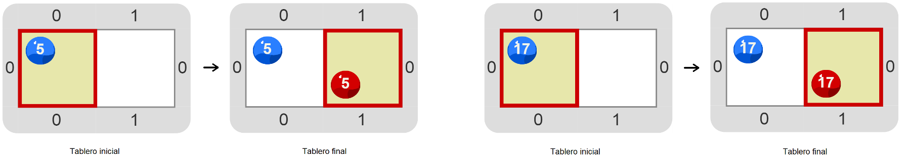

# Proyecto 'Otra vez el cabezal juega a ser mimo'

¿Te acordás de la actividad _“El cabezal puede contar”_ del capítulo 4? Ahí el cabezal tenía que imitar la cantidad de bolitas azules usando bolitas rojas y tuviste que descubrir la expresión primitiva `nroBolitas` para hacerlo. En esta actividad hay que hacer algo parecido: imitar las bolitas azules de la celda actual con bolitas rojas; ¡_pero_ la gran diferencia es que la imitación tiene que hacerse _en la celda de al lado_! Tenés que construir un programa que imite la cantidad de bolitas azules de la celda actual, poniendo la misma cantidad de bolitas rojas en la celda de al lado, al Este. Como siempre, el programa tiene que funcionar en varios tableros diferentes. Te mostramos algunos tableros iniciales y sus correspondientes tableros finales.

Vas a precisar alguna forma de recordar cuántas bolitas azules hay en la celda actual antes de moverte al Este, porque si te movés sin recordar, ¡la expresión nroBolitas(Azul) te va a dar cero y no el número que precisás! Tenés que explorar el entorno una vez más. 

Lo que necesitás es algo que funcione como el papel en el juego del mensaje. Cuando lo encuentres, acordate de que elegir nombres adecuados para las cosas es importante. ¿Qué te parece `cantidadDeAzulesAImitar` para el nombre con el que recordar el dato importante?  

[Enunciado en PDF][PDF]

[PDF]: https://raw.githubusercontent.com/Program-AR/proyectos-gobstones-jr/master/Proyectos/Cap.7/710.Otra%20vez%20el%20cabezal%20juega%20a%20ser%20mimo/assets/resources/description.pdf "Enunciado de 'Otra vez el cabezal juega a ser mimo' en PDF"
