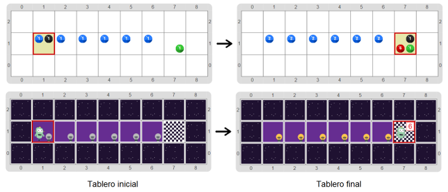

# Proyecto 'Super Lucho también cuenta luces'

Una vez más tenemos que ayudar a Lucho a prender las luces. Al igual que en la actividad _Super Lucho”_, hay una fila de luces que termina en una meta, pero no sabemos cuántas hay. El programa que tenés que construir en este proyecto tiene que hacer que Lucho prenda todas las luces y, al llegar a la meta, anotar, usando bolitas rojas, cuántas luces prendió. Te mostramos un tablero inicial y su correspondiente tablero final, con y sin vestimenta.

Una vez más, vas a precisar una variable. Pero ahora no alcanza con usarla una vez: cada vez que prendas una luz, la variable va a tener que incrementarse para acumular el valor necesario; para eso, se puede usar el valor de la variable, sumarle uno y volverlo a recordar en la misma variable. Es como si agregaras un palito en el papel, cada vez que prendés una luz. En el código que te damos, eso ya viene hecho para que aprendas cómo se hacer, pero tenés que completar el resto del programa para conseguir el propósito. Fijate el nombre que le dimos a la variable: `cantidadDeLucesQueYaPrendí`. ¿Cuánto tiene que valer al principio?

> **Nomenclatura**
>
> Cuando una variable se usa de la forma en que lo hicimos en este programa, incrementándose de a poco durante un recorrido, se le da el nombre de **acumulador** o **contador**, porque se usa para ir acumulando las cantidades que se van contando.

[Enunciado en PDF][PDF]

[PDF]: https://raw.githubusercontent.com/Program-AR/proyectos-gobstones-jr/master/Proyectos/Cap.7/711.Super%20Lucho%20tambi%C3%A9n%20cuenta%20luces/assets/resources/description.pdf "Enunciado de 'Super Lucho también cuenta luces' en PDF"
