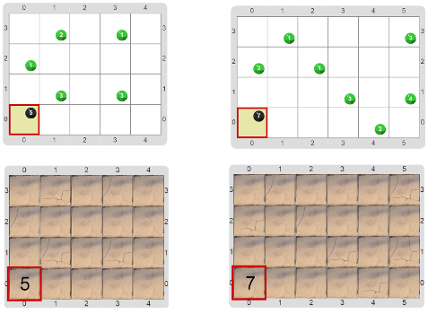

# Proyecto 'Contar las baldosas rajadas'

Construí un programa que cuente las baldosas rajadas que hay en el patio. Una baldosa está rajada si tiene al menos una bolita verde. La idea es que modifiques el programa de la parte anterior para que no cuente todas, sino solamente las rajadas. Te mostramos algunos tableros finales, sin vestimenta y con ella.

¡No te olvides de definir procedimientos y funciones para que tus programas sean legibles!

[Enunciado en PDF][PDF]

[PDF]: https://raw.githubusercontent.com/Program-AR/proyectos-gobstones-jr/master/Proyectos/Cap.7/713.Contar%20las%20baldosas%20rajadas/assets/resources/description.pdf "Enunciado de 'Contar las baldosas rajadas' en PDF"
