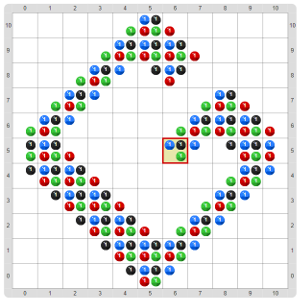

# Proyecto 'Editor de tableros'

Completá el programa para que se puedan editar tableros de Gobstones. El programa debe permitir:
* mover el cabezal usando las flechas direccionales (ya provisto),
* poner una bolita negra con la tecla ‘N’,
* poner una bolita azul con la tecla ‘A’,
* poner una bolita roja con la tecla ‘R’,
* poner una bolita verde con la tecla ‘V’,
* sacar una bolita negra con la tecla ‘N’ modificada con la tecla ‘MAY’ (o ‘SHIFT’),
* sacar una bolita azul con la tecla ‘A’ modificada con la tecla ‘MAY’ (o ‘SHIFT’
* sacar una bolita roja con la tecla ‘R’ modificada con la tecla ‘MAY’ (o ‘SHIFT’),
* sacar una bolita verde con la tecla ‘V’ modificada con la tecla ‘MAY’ (o ‘SHIFT’),

Cómo pudiste comprobar, un programa interactivo requiere que vos le indiques qué hacer cuando se toca una tecla. Para eso tenés que descubrir algunas herramientas nuevas. ¡A explorar!

Cuando termines, probalo armando algunos tableros interactivamente. Buscá cómo hacer para guardar los tableros que armes, para volver a cargarlos en otros proyectos...

Como desafíos adicionales, podés tratar de ver cómo hacer para que el programa no falle al moverse con las flechas o sacar, cómo hacer para ir al borde con una sola tecla y cómo hacer para poner o sacar 10 bolitas al mismo tiempo. Para moverse al borde o poner muchas juntas podés usar la tecla ‘CTRL’ como modificador. 

[Enunciado en PDF][PDF]

[PDF]: https://raw.githubusercontent.com/Program-AR/proyectos-gobstones-jr/master/Proyectos/Cap.8/802.Editor%20de%20tableros/assets/resources/description.pdf "Enunciado de 'Editor de tableros' en PDF"
