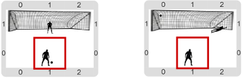

# Proyecto 'Definición por penal'

Ahora tenés que programar el juego de los penales, en donde un jugador elige la dirección hacia donde va a patear el penal y otro jugador elige la dirección hacia donde va a tirarse el arquero. Los jugadores disponen de 3 opciones utilizando las siguientes teclas:

<table border="1" width="45%">
<tr>
 <th align="center">  Tecla  <th> Opción para el arquero     <th align="center"> Tecla <th> Opción para patear el penal
<tr>
 <td align="center">   ‘Q’   <td> Se tira hacia la izquierda <td align="center">  ‘I’  <td> Patea hacia la izquierda
<tr>
 <td align="center">   ‘W’   <td> Lo deja en el centro       <td align="center">  ‘O’  <td> Patea hacia el centro
<tr>
 <td align="center">   ‘E’   <td> Se tira hacia la derecha   <td align="center">  ‘P’  <td> Patea hacia la derecha
<tr>
 <td align="center"> ‘ENTER’ <td colspan="3">  
                               Resetea el juego volviendo al estado inicial 
                               
                               (buscá el procedimiento primitivo que te ayuda a volver al estado inicial del juego)
</table>

Tené en cuenta que el penal debe resolverse recién cuando los dos jugadores hayan hecho una elección; además, el que elige primero puede cambiar la elección, pero cuando el segundo elige, se ejecuta el penal. Usando ‘ENTER’ se puede jugar varias veces en la misma ejecución. Las vestimentas van a hacer que al jugar no se vean la opciones elegidas; ¡si no, sería re-fácil elegir siempre la opción que gane para el que elige segundo! 

Inicialmente el arquero está en el medio del arco y la pelota una posición hacia el sur. Luego de efectuar el penal tanto el arquero como la pelota deben estar en la posición del arco elegida por los jugadores. Usamos la siguiente representación:

 * La pelota se representa con 1 bolita negra.
 * El arquero, con 2 bolitas negras.
 * Las opciones de los jugadores se representan con 1, 2, ó 3 bolitas verdes o azules sobre la pelota, dependiendo si eligen izquierda, centro o derecha y si la elección es para atajar o patear, respectivamente.
 
¡Acordate de dividir en subtareas! Podrías tener `PonerOpción(...)`, `Patear(...)`, `Atajar(...)`, `EjecutarPenal`, `MoverArquero`, `MoverPelota`, etc. Te damos algunas funciones ya definidas para que no tengas que recordar las codificaciones; ¡vos también podés usar esta técnica en tus propios programas!

Finalmente, te aconsejamos que, para hacer las cosas más fáciles, al terminar cada procedimiento, el cabezal siempre vuelva a estar en el centro, en la posición donde está la pelota al empezar y así todas las subtareas pueden suponer esto cuando empiezan
          
[Enunciado en PDF][PDF]

[PDF]: https://raw.githubusercontent.com/Program-AR/proyectos-gobstones-jr/master/Proyectos/Cap.8/804.Definici%C3%B3n%20por%20penal/assets/resources/description.pdf "Enunciado de 'Definición por penal' en PDF"
