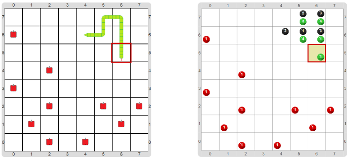

# Proyecto 'Snake'

En esta actividad vas a programar una versión simplificada del juego Snake, que en castellano sería “La víbora”. El juego es un programa interactivo donde el jugador elige en qué dirección mover la víbora con las teclas direccionales. Cuando la víbora se mueve, todo su cuerpo la sigue excepto si encuentra una manzana en su camino, en cuyo caso se la come y se estira un segmento. Si la víbora intenta moverse fuera del tablero o sobre su propio cuerpo, el programa debe terminar con un BOOM. Si pasado cierto tiempo, el jugador no ha presionado una tecla, la víbora debe seguir moviéndose en la dirección de su último movimiento. 

La parte de asociar las teclas de flechas ya te la podés imaginar, porque es similar a las que hicimos en actividades anteriores… Para la parte de qué hacer cuando el jugador no toca ninguna tecla después de cierto tiempo, hay una asociación especial. ¡Indagá para encontrarla y ver cómo funciona! Asegurate de probar con diferentes cantidades de tiempo; en la máquina que probamos nosotros, 500 milisegundos da un juego interesante.

Para la representación de información, debemos representar cada segmento de la víbora. Pero para que el recorrido sobre la víbora sea sencillo, cada segmento debe tener una representación de dónde está el segmento posterior y también el anterior. Usamos la siguiente representación:
  * Cada segmento de la víbora se representa en una celda, usando bolitas verdes y negras. 
  * Las bolitas verdes codifican la dirección hacia donde está el segmento posterior y las bolitas negras codifican la dirección hacia donde está el segmento anterior.
  * Las direcciones se codifican con 1 bolita para Norte, 2 bolitas para Este, 3 bolitas para Sur y 4 bolitas para Oeste.
  * Las manzanas se representan con 1 bolita roja.
  
Una consecuencia de esta codificación es que la cabeza es la única que no tiene bolitas negras, porque no tiene segmento anterior, y la cola es la única que no tiene bolitas verdes, porque no tiene posterior. Entonces, para saber si en una celda hay un segmento de una víbora hay que ver si hay bolitas verdes _o bien_ bolitas negras, porque puede haber de una, de la otra o de las dos.

En el tablero inicial debe haber una víbora correctamente codificada con el cabezal ubicado sobre su cabeza, y algunas manzanas.

Para ayudarte un poco, te damos los siguientes procedimientos y funciones primitivas:
  * `CodificarSegmento(dir,color)`, que codifica en la celda actual una dirección con bolitas del color indicado,
  * `direcciónDelÚltimoMovimiento`, que usada en la cabeza de la víbora indica para dónde se debería mover,
  * `dirSegmentoAnterior`, que parada en un segmento distinto de la cabeza, indica para qué dirección se encuentra el segmento anterior, y
  * `dirSegmentoPosterior`, que parada en un segmento distinto de la cola, indica para qué dirección se encuentra el segmento posterior.
  
También te sugerimos algunas subtareas que tendrías que hacer:
  * Para mover la víbora en una dirección dada, hay que alargar la cabeza y después decidir si es necesario comer un manzana o acortar la cola (pero no las dos): 
  
  `MoverVíbora(direcciónDeMovimiento)`.
  * Para acortar la cola, hay que recorrer desde la cabeza a la cola, acortar la cola ajustando las bolitas necesarias, y luego volver a recorrer desde la cola a la cabeza (para que el cabezal siempre esté en la cabeza de la víbora al empezar cada ciclo):
  
  `AcortarLaCola()`.
  * Alargar la cabeza requiere saber para dónde se mueve, codificar los nuevos segmentos, y también verificar que no se caiga del tablero ni se choque con ella misma:
  
  `AlargarLaCabeza(dirección)`.

Otras subtareas posibles sirven para recorrer la víbora desde la cabeza hasta la cola, y desde la cola hasta la cabeza; podrías llamarlas `IrDeLaCabezaALaCola` e `IrDeLaColaALaCabeza`, y hacerlas como un recorrido que se mueve al segmento posterior o anterior hasta que llega a la cola o la cabeza, respectivamente.

Y no te olvides de hacer funciones para preguntar si en una celda hay manzana, está la cabeza o la cola de la víbora, o si hay alguna parte de la víbora.
         
[Enunciado en PDF][PDF]

[PDF]: https://raw.githubusercontent.com/Program-AR/proyectos-gobstones-jr/master/Proyectos/Cap.8/805.Snake/assets/resources/description.pdf "Enunciado de 'Snake' en PDF"
