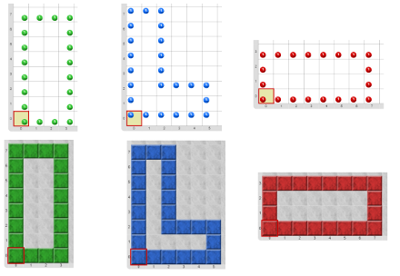

# Proyecto 'Dibujar figuras con subtareas, revisado'

Otra vez más, tenés que dibujar cuatro cuadrados, tal como en la actividad _“Dibujar figuras con subtareas”_, o sea, obtener el siguiente tablero final (mostrado con y sin vestimenta):

Pero esta vez hay que definir un único procedimiento para dibujar líneas. Para hacerlo, tenés que descubrir cómo usar el nuevo parámetro de dirección.

Para completar la actividad probá hacer más dibujos utilizando el procedimiento para definir líneas, como los de la figura, u otros. ¿Ves qué útil que resulta tener un procedimiento con parámetros?

 

[Enunciado en PDF][PDF]

[PDF]: https://raw.githubusercontent.com/Program-AR/proyectos-gobstones-jr/master/Proyectos/Cap.7/704.Dibujar%20figuras%20con%20subtareas,%20revisado/assets/resources/description.pdf "Enunciado de 'Dibujar figuras con subtareas, revisado' en PDF"

