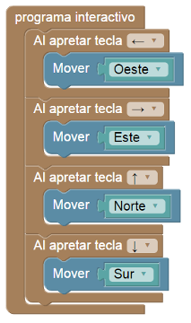

# Proyecto 'Al cabezal lo muevo yo'

¿Qué diferencias observás con respecto a los programas que venías haciendo?  ¿Podés explicar qué es lo que cambió en la ejecución? Si no te das cuenta, presioná alguna de las teclas de flechas durante la ejecución del programa…
El programa que vas a encontrar luce como el de la figura:

          
[Enunciado en PDF][PDF]

[PDF]: https://raw.githubusercontent.com/Program-AR/proyectos-gobstones-jr/master/Proyectos/Cap.8/801.Al%20cabezal%20lo%20muevo%20yo/assets/resources/description.pdf "Enunciado de 'Al cabezal lo muevo yo' en PDF"
