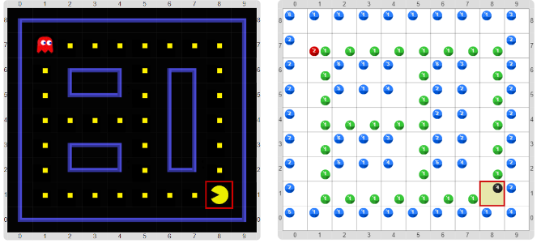

# Proyecto 'Pacman'

En esta actividad vas a programar una versión simplificada del juego del Pacman. En este juego el personaje Pacman debe navegar por un laberinto hasta comer todas las pastillas que se encuentran desperdigadas. Los jugadores pueden controlar los movimientos del Pacman usando las flechas direccionales del teclado, pero como el Pacman no puede atravesar las paredes del laberinto, si el jugador hace un movimiento inválido, el Pacman debe quedarse en el lugar. Además de comer todas las pastillas en el laberinto, el Pacman debe evadir a un Fantasma que lo persigue. Por cada movimiento del Pacman el Fantasma también debe hacer un movimiento que lo acerque al Pacman, ya sea horizontal o verticalmente. Al igual que el Pacman, el Fantasma no puede atravesar las paredes, así que si intenta hacer un movimiento inválido debe quedarse en el lugar, aunque si tiene al menos una opción válida que lo acerque debe tomarla. Si el fantasma entra en el mismo casillero que el Pacman, el jugador pierde la partida y el programa debe hacer BOOM.

> **El dato**
>
> Pacman es un juego de consola desarrollado en 1980, pionero de los juegos de persecución en laberintos. Ese juego y sus derivados se convirtieron en uno de los juegos clásicos más populares en existencia. 

  A) En primer lugar te recomendamos resolver solamente los movimientos del Pacman, y dejar el tema del Fantasma para una segunda parte. Para eso, primero tenés que entender cómo representar cada uno de los elementos, y después hacer los procedimientos que mueven al Pacman. La representación es la siguiente:
  
  * Las paredes se representan con bolitas azules, entre 1 y 6 dependiendo de si es una pared vertical, horizontal o una de las cuatro esquinas.
  * El Pacman se representa con bolitas negras, entre 1 y 4 dependiendo de si mira hacia el Norte, Este, Sur u Oeste, respectivamente.
  * Las pastillas se representan con una bolita verde.
  * El Fantasma se representa con bolitas rojas, también entre 1 y 4, con la misma codificación de direcciones que el Pacman.

Podrías comenzar haciendo funciones para decir `pacman` en lugar de `Negro`, `fantasma` en lugar de `Rojo`, `pastilla` en lugar de `Verde`, etc. y también procedimientos para poner y sacar a los personajes, como por ejemplo, `SacarPersonaje(personajeASacar)` y `PonerPersonaje(personajeAPoner, direcciónAMirar)`. También podés hacer un procedimiento para mover a un personaje; recordá que mover a un personaje es sacarlo de una celda y ponerlo en la celda siguiente, pero solamente si en la celda destino no hay una pared. Para ver si hay un personaje en una celda, ya te damos construida una función `hayPersonaje(personaje)`.

Luego tendrías que construir un procedimiento para hacer la jugada del Pacman; recordá que el Pacman después de moverse debe ver si perdió; si perdió, termina el programa (con un BOOM, por ejemplo), pero si no perdió, debe comer la pastilla si la encontró (el control para ver si ganó, dejalo para después). Para terminar esta parte, tendrías que asociar las teclas correspondientes con las jugadas del Pacman.

> **Ayuda**
>
> Recordá que es fundamental una buena división en subtareas a la hora de programar. Y que podés reutilizar varios de los procedimientos y funciones hechos con anterioridad: `Poner__Veces`, `Mover__Veces`, `Sacar__Veces`, `SacarTodas`, `MoverSiPuede`, etc. ¡Para que no tengas que hacerlos de nuevo, te los damos como procedimientos primitivos!

  B) En segundo lugar tenés que hacer un procedimiento para hacer la jugada del Fantasma. Para esto te recomendamos reutilizar el procedimiento `BuscarEnCuadrante(color, direcciónHorizontal, direcciónVertical)` y la función `hayEnCuadrante(color, dirección1, dirección2)` de la actividad _“El radar”_ del Cap.8 (ya te las damos hechas, con los nombres un poquito más adecuados a esta actividad). También te recomendamos construir un procedimiento para decidir cómo mover al fantasma. Entonces, para hacer la jugada del Fantasma, primero llevamos el cabezal a dónde está el Fantasma, luego buscamos al Pacman en cada uno de los cuatro cuadrantes, y hacemos una movida del Fantasma hacia el cuadrante donde se encuentra el Pacman, y terminamos devolviendo el cabezal a la ubicación del Pacman (para que el cabezal siempre esté sobre un lugar fijo, en este caso, el Pacman).
  
  Para moverse hacia un cuadrante hay dos posibilidades, ya que hay dos direcciones: una principal y una secundaria (todo cuadrante queda dado por dos direcciones). Siempre que pueda moverse, debe hacerlo, por lo que hay que controlar si se puede mover en la dirección principal, y si puede, moverse en esa dirección, pero si no puede, intentarlo en la dirección secundaria. No te olvides de controlar si el Fantasma se encontró con el Pacman, ya que en ese caso, el juego terminó...
  
  C) Un desafío final, pero que no es necesario para poder jugar, es hacer una función que cuente el número de pastillas que quedan, y controlar así, después de comer cada pastilla, si el Pacman ganó, cuando no quedan más pastillas. La cuenta de pastillas se haría de forma muy parecida a como hiciste en la segunda parte de la actividad _“Contar las baldosas”_ del Cap.8 con una función con procesamiento usando un acumulador. 

[Enunciado en PDF][PDF]

[PDF]: https://raw.githubusercontent.com/Program-AR/proyectos-gobstones-jr/master/Proyectos/Cap.8/806.Pacman/assets/resources/description.pdf "Enunciado de 'Pacman' en PDF"
