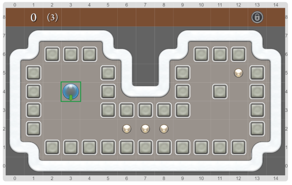

# Welcome to Quell

Run the program, and swipe the raindrop in the direction of the arrow, using the arrows in your keyboard.

If you want to try again, use R to reset. To quit, stop the program with the stop button.

